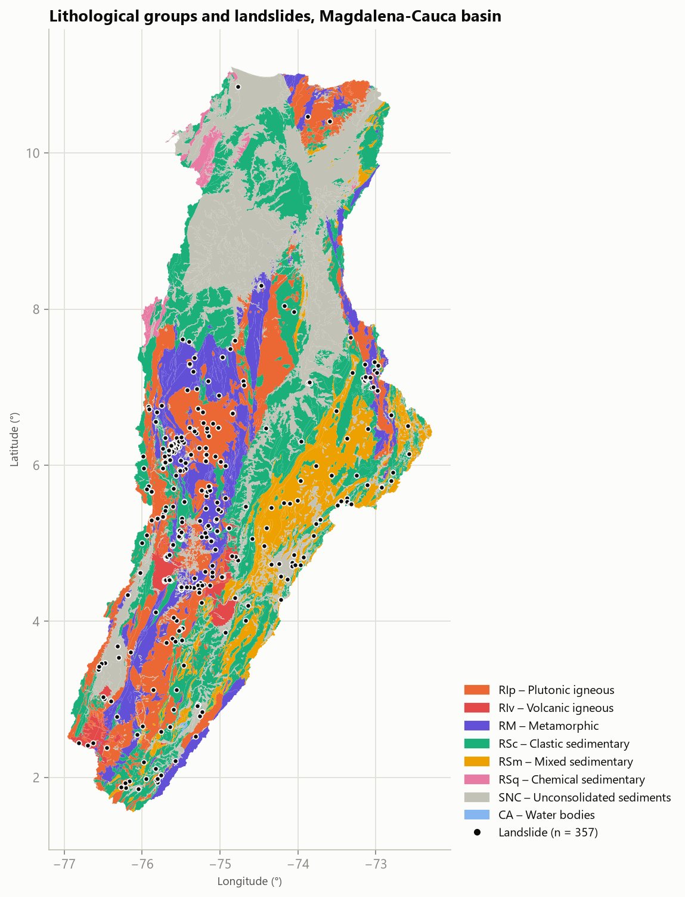
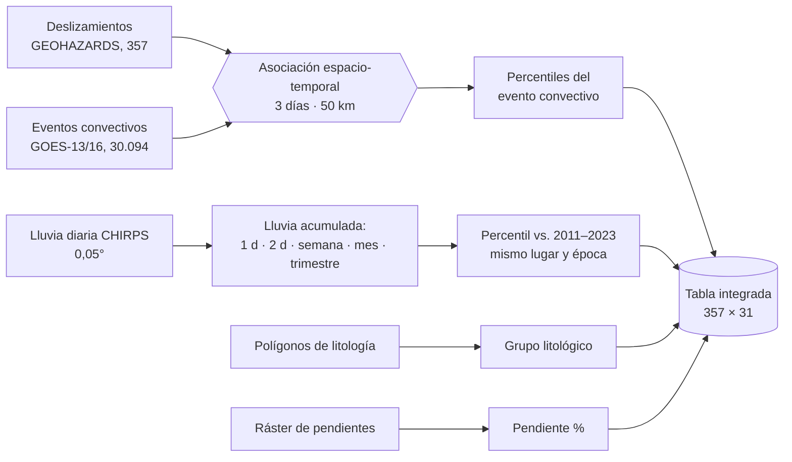
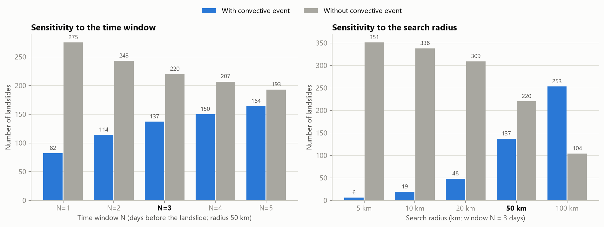
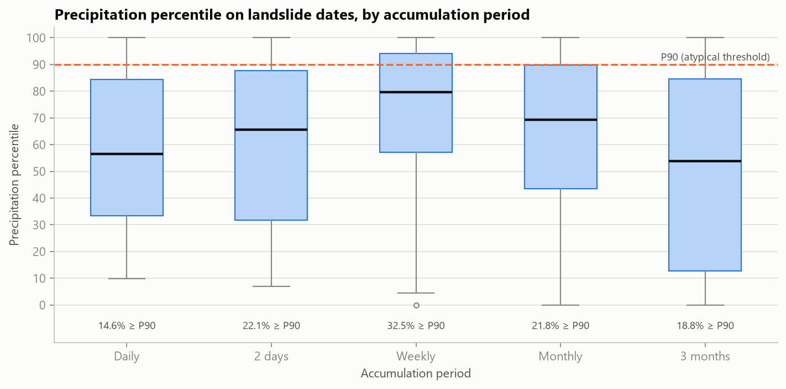
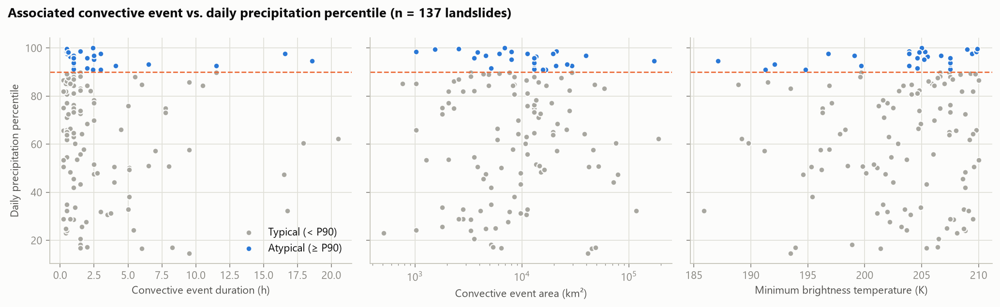
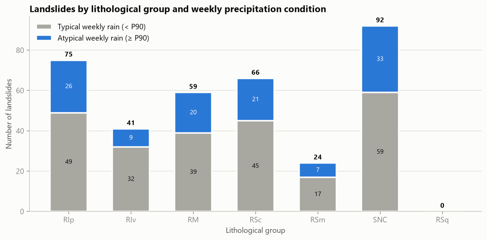
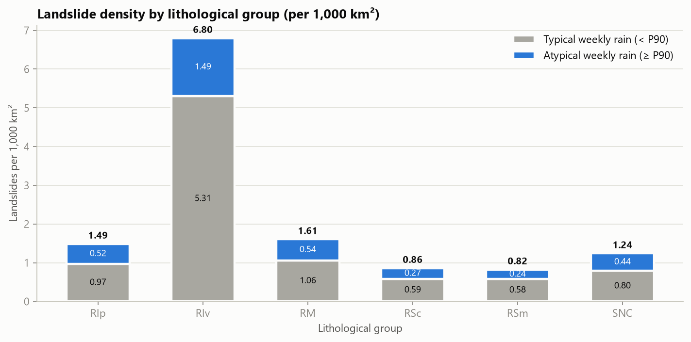
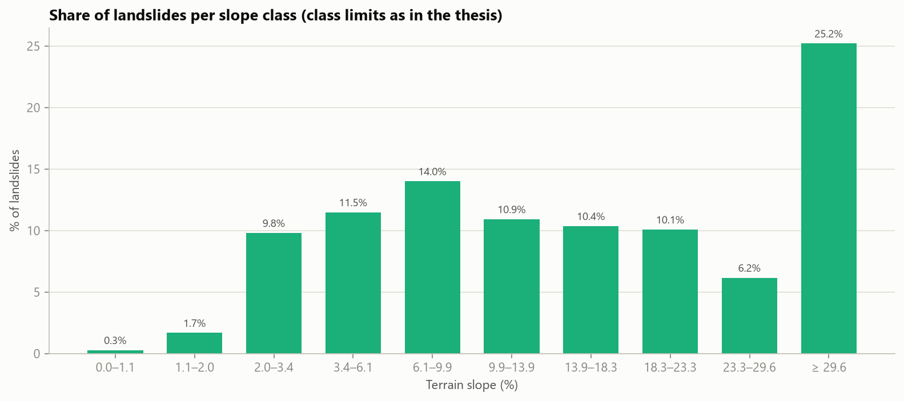

# Deslizamientos y convección atmosférica profunda en la cuenca Magdalena–Cauca (Colombia, 2011–2023)

[English](README.md) · **Español**

Código de mi trabajo de grado en Geología (Universidad Nacional de Colombia, sede Bogotá,
2025), dirigido por el profesor Daniel Hernández Deckers.

El proyecto construye una sola base de datos geoespacial que une **357 deslizamientos**,
**30.094 eventos de convección profunda** detectados con imágenes infrarrojas del satélite
GOES, la **precipitación diaria CHIRPS**, la **litología** y la **pendiente del terreno**.
Con esa base se evalúa si la convección profunda y la lluvia atípica explican dónde y cuándo
ocurren los deslizamientos en la principal cuenca del país (~275.000 km²).



## Resultados principales

- **No se encontró una relación clara entre los eventos convectivos y los deslizamientos.**
  Ninguna propiedad del evento (duración, área, temperatura mínima del tope de nube)
  diferencia los deslizamientos con lluvia extrema de los demás.
- **La escala semanal es la más relevante.** La lluvia acumulada semanal es la escala con
  mayor proporción de valores atípicos (≥ P90): **32,5 %** de los deslizamientos. Aun así,
  el **67,5 %** ocurrió con lluvia típica.
- **Las rocas ígneas volcánicas (RIv)** tienen la mayor densidad de deslizamientos,
  **6,8 por cada 1.000 km²**. No se registraron deslizamientos en rocas sedimentarias
  químicas (RSq).
- El **25 %** de los deslizamientos ocurrió en pendientes mayores al 30 %.
- El inventario (357 eventos para 275.000 km² en 13 años) probablemente no es
  representativo. Se necesita una recolección de datos más completa y estandarizada.

## Metodología



1. **Asociación.** Para cada deslizamiento se buscan todos los eventos convectivos ocurridos
   hasta **N = 3 días** antes y a menos de **50 km**. Si hay varios, se conserva el de mayor
   área. Ambos valores se eligieron con un análisis de sensibilidad (Figura 5).
2. **Percentiles de precipitación.** La lluvia acumulada antes de cada deslizamiento se
   compara con una población de acumulados para las mismas coordenadas y la misma época del
   año, construida con todos los años 2011–2023. Un valor igual o mayor al **percentil 90**
   se considera *atípico*.
3. **Geología.** A cada deslizamiento se le asigna un grupo litológico y un valor de
   pendiente. Los grupos litológicos son una reagrupación, propuesta en la tesis, de las
   unidades hidrogeológicas de Cárdenas Giraldo (2022).

| Código | Grupo |
|---|---|
| RIv | Rocas ígneas volcánicas |
| RIp | Rocas ígneas plutónicas |
| RM | Rocas metamórficas |
| RSc | Rocas sedimentarias clásticas |
| RSm | Rocas sedimentarias mixtas |
| RSq | Rocas sedimentarias químicas |
| SNC | Sedimentos no consolidados |

## Resultados

Todas las figuras se vuelven a generar a partir de los CSV de `data/` con
`scripts/make_figures.py`. Las etiquetas de las figuras están en inglés. Las figuras
originales de la tesis, en español, están en [`figures/thesis/`](figures/thesis).

**Elección de la ventana de tiempo y del radio de búsqueda**


**Percentil de precipitación en la fecha de los deslizamientos**


**Propiedades del evento convectivo vs. percentil de precipitación diaria**


**Deslizamientos por grupo litológico**



**Pendiente del terreno**


## Estructura del repositorio

```
├── data/
│   ├── raw/          deslizamientos + eventos convectivos (insumos)
│   ├── processed/    tabla de resultados de la tesis, series CHIRPS por deslizamiento, resúmenes
│   └── external/     (no incluido) CHIRPS original, shapefile de litología, ráster de pendientes
├── src/
│   ├── config.py         rutas y parámetros
│   ├── association.py    asociación deslizamiento ↔ evento convectivo, percentiles del evento
│   ├── chirps_extract.py serie diaria CHIRPS alrededor de cada deslizamiento (xarray)
│   ├── precipitation.py  acumulados y percentiles de CHIRPS (Python o CDO)
│   ├── geology.py        cruce con litología y extracción de pendiente
│   └── pipeline.py       punto de entrada por línea de comandos
├── scripts/make_figures.py   genera todas las figuras de resultados
├── figures/
│   ├── generated/    figuras producidas por el código
│   └── thesis/       figuras originales del documento de tesis
└── legacy/           el script original, tal como se ejecutó en el servidor de la universidad
```

## Cómo ejecutarlo

Requiere Python 3.10 o superior (probado con 3.13 en Windows).

```bash
python -m venv .venv
source .venv/bin/activate        # Windows: .venv\Scripts\activate
pip install -r requirements.txt

# Generar las figuras de resultados con los datos incluidos (cerca de 1 minuto;
# el mapa litológico también requiere el shapefile en data/external/)
python scripts/make_figures.py

# Asociación, percentiles convectivos y precipitación CHIRPS con los datos incluidos
python src/pipeline.py --days 3 --radius 50 --skip-geology

# Pipeline completo (también litología y pendiente): requiere el shapefile y el ráster en data/external/
python src/pipeline.py --days 3 --radius 50

# Reconstruir las series CHIRPS desde los archivos globales originales (~14 GB, ~1 min)
python src/chirps_extract.py --chirps-dir <carpeta con chirps-v2.0.<año>.days_p05.nc>
```

**Verificación de reproducibilidad.** El pipeline reorganizado reproduce la tabla original
de la tesis (357 filas × 31 columnas). La única diferencia es un percentil diario (0,26
puntos), causada por dos días cuya lluvia difiere en 0,0001 mm. La ejecución original en el
servidor tomaba horas de llamadas a CDO. La versión en Python corre en unos 10 segundos en
un portátil.

El método original con CDO sigue disponible con `--precip-backend cdo`. Requiere
[CDO](https://anaconda.org/conda-forge/cdo) (Linux/macOS o WSL) y los NetCDF recortados.

## Datos

| Base de datos | Fuente | Incluida |
|---|---|---|
| Inventario de deslizamientos | [Geovisor GEOHAZARDS](https://geohazards.com.co/), Universidad Nacional de Colombia (Medellín), depurado para este estudio. El archivo tiene 366 registros (2011–2024); se usan los 357 de 2011–2023 | ✅ `data/raw/` |
| Eventos de convección profunda | Derivados de imágenes IR de GOES-13 (2011–2017) y GOES-16 (2018–2023), siguiendo a [Hernández-Deckers (2022)](https://doi.org/10.1002/qj.4208) | ✅ `data/raw/` |
| Tabla integrada de resultados | Salida de este proyecto (3 días, 50 km) | ✅ `data/processed/` |
| Precipitación diaria a 10 km de cada deslizamiento | Extraída de [CHIRPS v2.0](https://www.chc.ucsb.edu/data/chirps) (0,05°) con `src/chirps_extract.py` | ✅ `data/processed/` (3 MB) |
| Precipitación diaria, original | Archivos diarios globales de [CHIRPS v2.0](https://www.chc.ucsb.edu/data/chirps), 2011–2023 (~14 GB), [descarga directa](https://data.chc.ucsb.edu/products/CHIRPS/v2.0/global_daily/netcdf/p05/) | ❌ descargar de la fuente |
| Unidades hidrogeológicas | Cárdenas Giraldo (2022), [repositorio UNAL](https://repositorio.unal.edu.co/handle/unal/82871) | ❌ |
| DEM / pendiente | DEM SRTM 30 m del IGAC, [Colombia en Mapas](https://www.colombiaenmapas.gov.co/); ráster de pendientes derivado de él (píxeles de ~38 m) | ❌ |

Definición de evento convectivo: temperatura de brillo < 235 K, con al menos un píxel
< 210 K y un descenso de ≥ 50 K en dos horas (área 1°N–11,5°N, 77,5°W–71,75°W).

## Notas y limitaciones

- **Las ventanas incluyen el día del deslizamiento.** El acumulado "semanal" suma los 7
  días previos más el día del evento. El "mensual" suma 30 + 1 días y el "trimestral"
  90 + 1 días, exactamente como en la tesis.
- **Archivos anuales de CHIRPS.** En la tesis, los acumulados se leían de un archivo CHIRPS
  por año, así que una ventana que cruza el 1 de enero solo suma los días del año del
  deslizamiento. La versión en Python reproduce esto a propósito, para coincidir con la tesis.
- **Diferencias con algunas figuras de la tesis.**
  - La Figura 4 de la tesis (deslizamientos por año) se hizo con una versión anterior del
    inventario que incluía 2024. La figura regenerada usa la tabla final 2011–2023.
  - En el conteo por litología, 4 deslizamientos aparecen como RM en la tabla final pero
    como RIp en la figura de la tesis. Los totales y los conteos atípicos son iguales.
  - Las clases de pendiente usan los límites reportados en la tesis, redondeados a un
    decimal.
- **Clases de pendiente (Figura 10).** Los límites de clase son los deciles del ráster de
  pendientes de la cuenca en grados, mientras que la pendiente de los deslizamientos está en
  porcentaje. La figura se conserva como en la tesis, así que sus clases no tienen igual área
  en unidades de porcentaje, y la disminución entre 10 % y 30 % debe leerse con eso en
  cuenta. La afirmación "el 25 % de los deslizamientos ocurrió en pendientes mayores al 30 %"
  solo usa porcentaje y no se ve afectada (24,9 %).
- **Áreas de la litología.** En la tesis el área de cada grupo litológico se midió en Web
  Mercator (EPSG:3857), que sobrestima las áreas entre 1 y 3 % en estas latitudes. Con una
  proyección de áreas iguales (EPSG:9377), la densidad de las RIv es 6,87 en vez de 6,80 por
  cada 1.000 km². El orden de los grupos y las conclusiones no cambian. Ambas tablas están en
  `data/processed/` (`lithology_summary.csv` y `lithology_summary_equal_area.csv`).
- Con el shapefile de litología y el ráster de pendientes en `data/external/`, los pasos de
  litología y pendiente del pipeline reorganizado asignan el mismo grupo, litología, edad y
  pendiente que la tesis a los 357 deslizamientos. El ráster de pendientes (1,4 GB, píxeles
  de 38 m) es demasiado grande para GitHub; se puede reconstruir a partir del DEM del IGAC.
- El script original de la investigación (con rutas del servidor y preguntas por teclado)
  se conserva sin cambios en [`legacy/`](legacy), por transparencia.

## Cómo citar

Muñoz Laiton, F. (2025). *Estudio de la relación entre fenómenos de remoción en masa y
eventos de convección atmosférica profunda en la cuenca Magdalena Cauca colombiana entre
2011 y 2023* [Trabajo de grado, Universidad Nacional de Colombia]. Director:
D. Hernández Deckers.

## Licencia

El código se publica bajo la [licencia MIT](LICENSE). Los datos pertenecen a las fuentes
originales mencionadas arriba.
