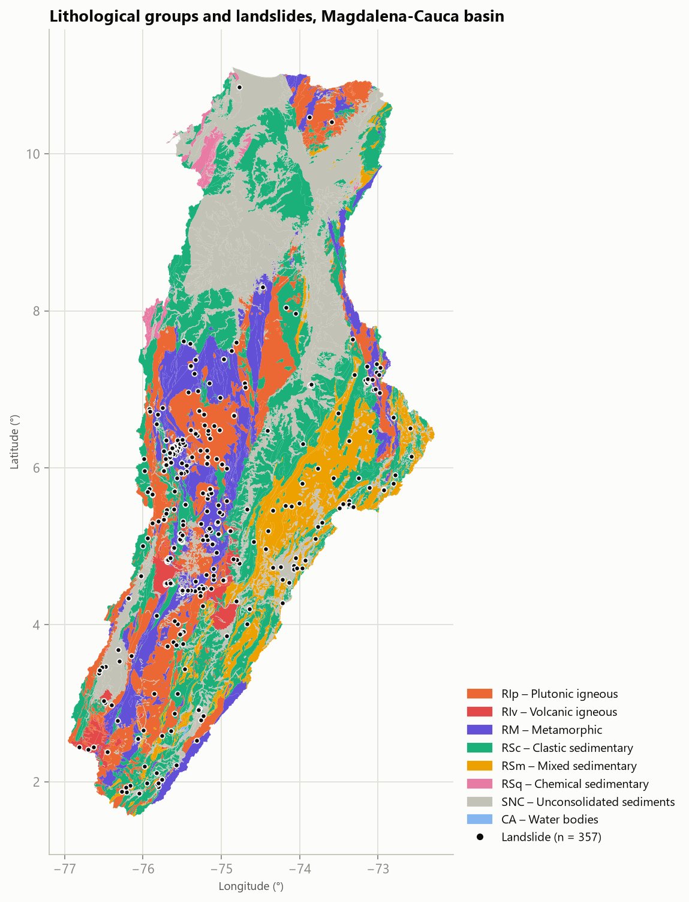
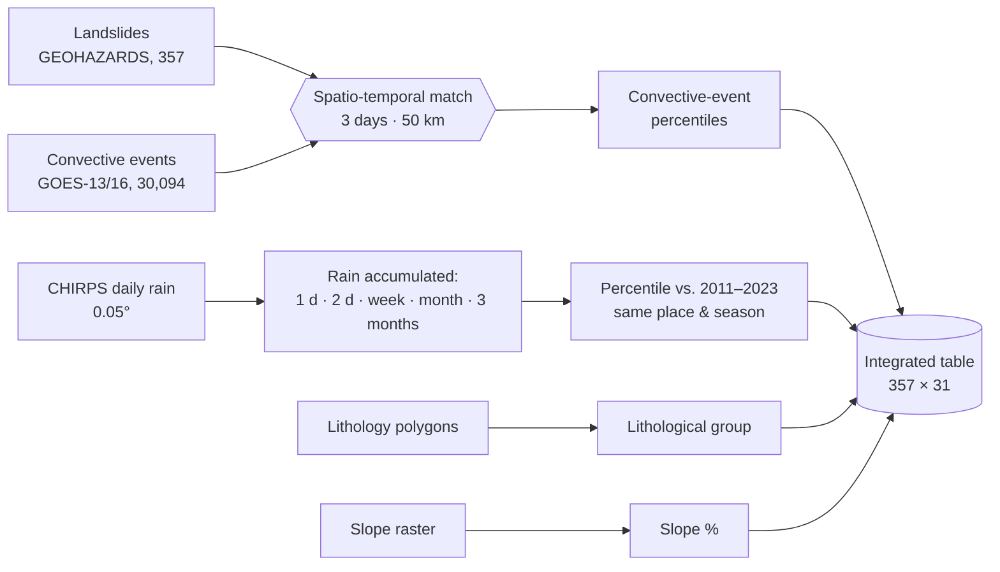
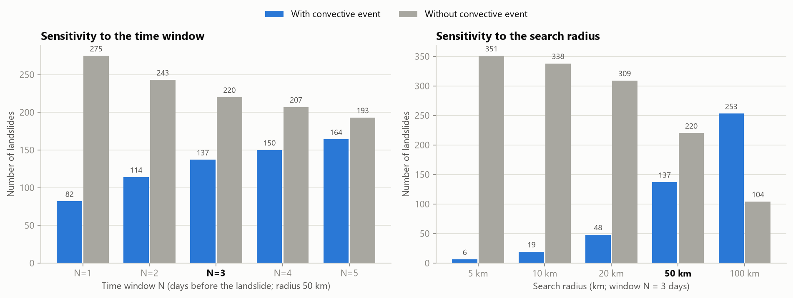
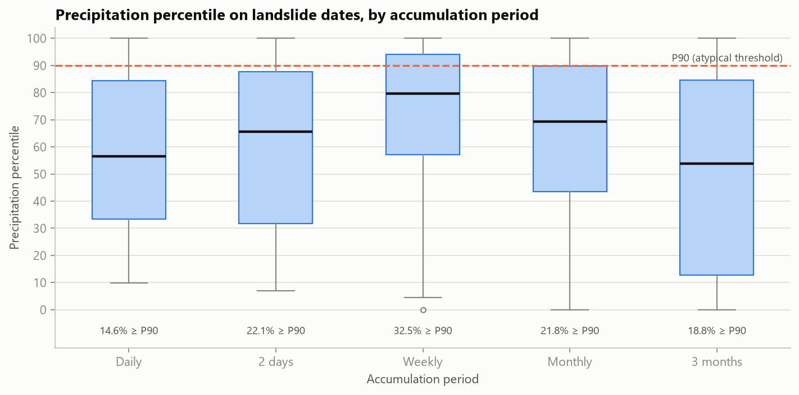
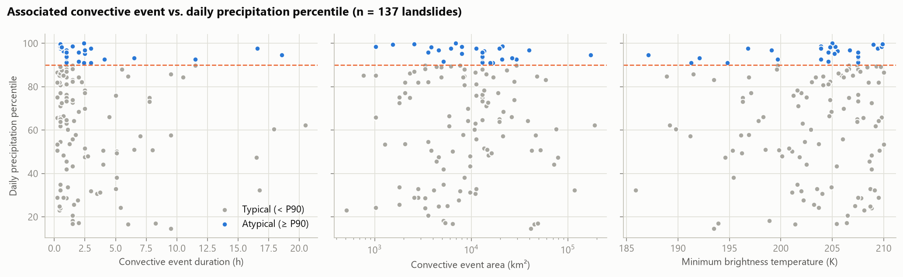
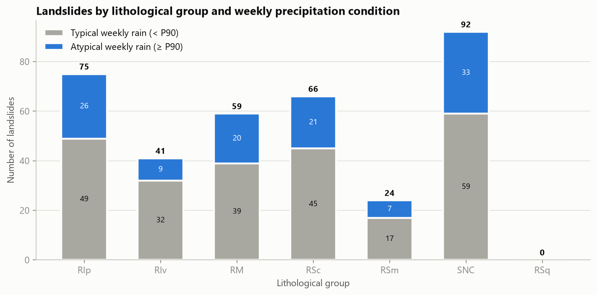
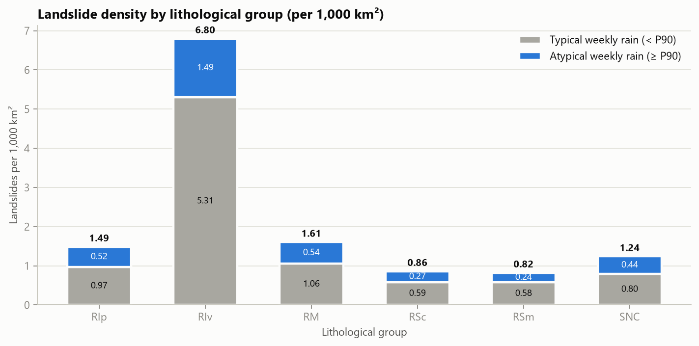
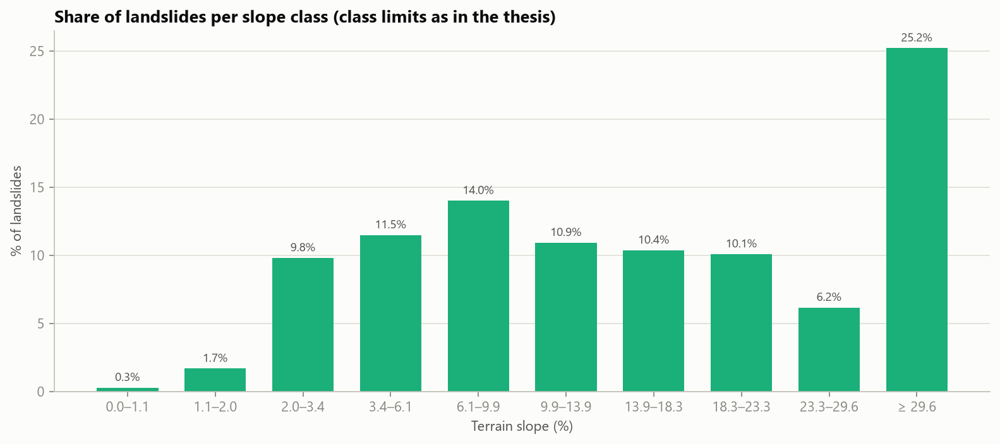

# Landslides and deep atmospheric convection in the Magdalena–Cauca basin (Colombia, 2011–2023)

**English** · [Español](README.es.md)

Code for my undergraduate thesis in Geology (Universidad Nacional de Colombia, Bogotá, 2025),
supervised by Prof. Daniel Hernández Deckers.

The project builds a single geospatial database that joins **357 landslides**, **30,094 deep
convective events** detected with GOES infrared imagery, **daily CHIRPS precipitation**, the
**lithology** and the **terrain slope**. With that database it tests whether deep convection
and unusual rainfall explain where and when landslides happen in Colombia's main river basin
(~275,000 km²).



## Key findings

- **No clear link between deep convective events and landslides.** None of the event's
  properties (duration, area, minimum cloud-top temperature) separates landslides that had
  extreme rain from those that did not.
- **The weekly scale matters most.** Weekly accumulated rain is the time scale with the
  highest share of atypical (≥ P90) values: **32.5 %** of landslides. Even so, **67.5 %**
  of the landslides happened with typical rainfall.
- **Volcanic igneous rocks (RIv)** have the highest landslide density, **6.8 per 1,000 km²**.
  No landslides were recorded on chemical sedimentary rocks (RSq).
- **25 %** of landslides occurred on slopes steeper than 30 %.
- The landslide inventory (357 events for 275,000 km² over 13 years) is probably not
  representative. Better and more standardised data collection is needed.

## Method



1. **Association.** For each landslide, find every convective event that happened up to
   **N = 3 days** before it and within **50 km** of it. When several events match, keep the
   one with the largest area. Both values were chosen with a sensitivity analysis
   (Figure 5).
2. **Precipitation percentiles.** Rain accumulated before each landslide is compared with
   a population of accumulations for the same coordinates and season, built from all years
   2011–2023. A value at or above the **90th percentile** is considered *atypical*.
3. **Geology.** Each landslide gets a lithological group and a slope value.
   The lithological groups are a re-grouping, proposed in the thesis, of the
   hydrogeological units of Cárdenas Giraldo (2022).

| Code | Group |
|---|---|
| RIv | Volcanic igneous rocks |
| RIp | Plutonic igneous rocks |
| RM | Metamorphic rocks |
| RSc | Clastic sedimentary rocks |
| RSm | Mixed sedimentary rocks |
| RSq | Chemical sedimentary rocks |
| SNC | Unconsolidated sediments |

## Results

All the figures below are regenerated from the CSV files in `data/` by
`scripts/make_figures.py`. The original thesis figures (in Spanish) are in
[`figures/thesis/`](figures/thesis).

**Choosing the time window and search radius**


**Precipitation percentile on landslide dates**


**Convective event properties vs. daily precipitation percentile**


**Landslides by lithological group**



**Terrain slope**


## Repository structure

```
├── data/
│   ├── raw/          landslides + convective events (inputs)
│   ├── processed/    thesis result table, CHIRPS series per landslide, summaries
│   └── external/     (not included) raw CHIRPS, lithology shapefile, slope raster
├── src/
│   ├── config.py         paths and parameters
│   ├── association.py    landslide ↔ convective-event matching, event percentiles
│   ├── chirps_extract.py daily CHIRPS series around each landslide (xarray)
│   ├── precipitation.py  CHIRPS accumulations and percentiles (Python or CDO)
│   ├── geology.py        lithology join and slope sampling
│   └── pipeline.py       command-line entry point
├── scripts/make_figures.py   regenerates every result figure
├── figures/
│   ├── generated/    figures produced by the code
│   └── thesis/       original figures from the thesis document
└── legacy/           the original script exactly as it ran on the university server
```

## How to run

Requires Python 3.10 or newer (tested with 3.13 on Windows).

```bash
python -m venv .venv
source .venv/bin/activate        # Windows: .venv\Scripts\activate
pip install -r requirements.txt

# Regenerate the result figures from the included data (about 1 minute;
# the lithology map also needs the shapefile in data/external/)
python scripts/make_figures.py

# Association, convective percentiles and CHIRPS precipitation with the included data
python src/pipeline.py --days 3 --radius 50 --skip-geology

# Full pipeline (also lithology and slope): needs the shapefile and raster in data/external/
python src/pipeline.py --days 3 --radius 50

# Rebuild the CHIRPS series from the raw global CHIRPS files (~14 GB, ~1 min)
python src/chirps_extract.py --chirps-dir <folder with chirps-v2.0.<year>.days_p05.nc>
```

**Reproducibility check.** The cleaned-up pipeline reproduces the original thesis table
(357 rows × 31 columns). The only difference is one daily percentile (0.26 points), caused
by two days whose rainfall differs by 0.0001 mm. The original server run took hours of CDO
calls. The Python version runs in about 10 seconds on a laptop.

The original CDO method is still available with `--precip-backend cdo`. It needs
[CDO](https://anaconda.org/conda-forge/cdo) (Linux/macOS or WSL) and the cropped NetCDF
files.

## Data

| Dataset | Source | Included |
|---|---|---|
| Landslide inventory | [GEOHAZARDS geoviewer](https://geohazards.com.co/), Universidad Nacional de Colombia (Medellín), cleaned for this study. The file has 366 records (2011–2024); the 357 from 2011–2023 are used | ✅ `data/raw/` |
| Deep convective events | Derived from GOES-13 (2011–2017) and GOES-16 (2018–2023) IR imagery, following [Hernández-Deckers (2022)](https://doi.org/10.1002/qj.4208) | ✅ `data/raw/` |
| Integrated result table | Output of this project (3 days, 50 km) | ✅ `data/processed/` |
| Daily precipitation within 10 km of each landslide | Extracted from [CHIRPS v2.0](https://www.chc.ucsb.edu/data/chirps) (0.05°) by `src/chirps_extract.py` | ✅ `data/processed/` (3 MB) |
| Daily precipitation, raw | [CHIRPS v2.0](https://www.chc.ucsb.edu/data/chirps) global daily files 2011–2023 (~14 GB), [direct download](https://data.chc.ucsb.edu/products/CHIRPS/v2.0/global_daily/netcdf/p05/) | ❌ download from source |
| Hydrogeological units | Cárdenas Giraldo (2022), [UNAL repository](https://repositorio.unal.edu.co/handle/unal/82871) | ❌ |
| DEM / slope | IGAC SRTM 30 m DEM, [Colombia en Mapas](https://www.colombiaenmapas.gov.co/); slope raster derived from it (~38 m pixels) | ❌ |

Convective event definition: brightness temperature < 235 K, with at least one pixel
< 210 K and a drop of ≥ 50 K in two hours (box 1°N–11.5°N, 77.5°W–71.75°W).

## Notes and limitations

- **The windows include the landslide day.** The "weekly" accumulation covers the 7
  previous days plus the landslide day. The "monthly" one covers 30 + 1 days and the
  "3-month" one 90 + 1 days, exactly as computed in the thesis.
- **Yearly CHIRPS files.** In the thesis, accumulations were read from one CHIRPS file per
  year, so a window that crosses 1 January only sums the days of the landslide's year. The
  Python version reproduces this on purpose, to match the thesis.
- **Differences with some thesis figures.**
  - Thesis Figure 4 (landslides per year) was made with an earlier version of the
    inventory that included 2024. The regenerated one uses the final 2011–2023 table.
  - In the lithology counts, 4 landslides appear as RM in the final table but as RIp in
    the thesis figure. Totals and atypical counts are the same.
  - The slope classes use the class limits reported in the thesis, rounded to one decimal.
- **Slope classes (Figure 10).** The class limits are the deciles of the basin slope
  raster in degrees, while the landslide slopes are in percent. The figure is kept as in the
  thesis, so its classes are not of equal area in percent units, and the dip between 10 %
  and 30 % should be read with that in mind. The statement "25 % of landslides occurred on
  slopes steeper than 30 %" uses percent only and is not affected (24.9 %).
- **Lithology areas.** The thesis measured the area of each lithological group in Web
  Mercator (EPSG:3857), which overestimates areas by about 1–3 % at these latitudes. In an
  equal-area projection (EPSG:9377) the RIv density is 6.87 instead of 6.80 per 1,000 km².
  The ranking and the conclusions do not change. Both tables are in `data/processed/`
  (`lithology_summary.csv` and `lithology_summary_equal_area.csv`).
- With the lithology shapefile and the slope raster in `data/external/`, the lithology and
  slope steps of the cleaned-up pipeline give the same group, lithology, age and slope as
  the thesis for all 357 landslides. The slope raster (1.4 GB, 38 m pixels) is too large
  for GitHub; it can be rebuilt from the IGAC DEM.
- The original research script (with server paths and interactive prompts) is kept,
  unchanged, in [`legacy/`](legacy) for transparency.

## Citation

Muñoz Laiton, F. (2025). *Estudio de la relación entre fenómenos de remoción en masa y
eventos de convección atmosférica profunda en la cuenca Magdalena Cauca colombiana entre
2011 y 2023* [Undergraduate thesis, Universidad Nacional de Colombia]. Supervisor:
D. Hernández Deckers.

## License

Code released under the [MIT License](LICENSE). The datasets belong to their original
sources listed above.
